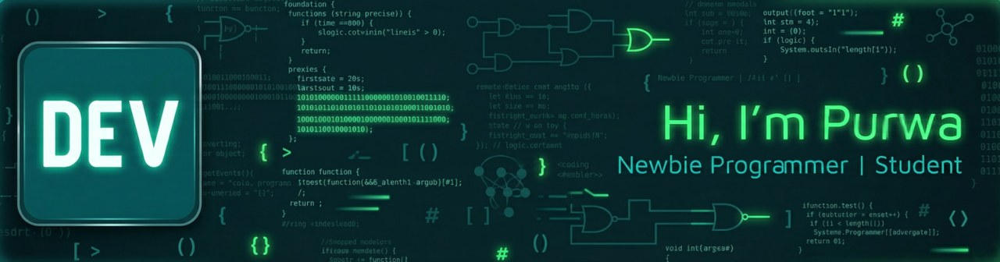

<div align="center">




### `Andrian Maulana Dzikwan` · `AN-maz`

**Informatics Student @ Universitas Teknologi Bandung**
Building, learning, breaking things, and understanding how they work.

[](https://github.com/AN-maz)
[](https://purtopolio.netlify.app/)
[](mailto:andrianian398@gmail.com)
[](https://github.com/AN-maz)

</div>

---

### `$ whoami`

I'm interested in building **full-stack applications** while strengthening my fundamentals in **software engineering, system design, Linux, and web security**.

I also enjoy collaborating, mentoring, and contributing to student technology communities.

---

### `$ tech --stack`

<p align="center">


</p>

---

### `$ currently`

```text
⚡ Building       Full-stack web projects
🧠 Learning       Software Engineering & System Design
🔐 Exploring      Cybersecurity / Web Security
🌱 Growing        Open Source & Collaborative Development
👥 Community      Mentoring & Student Tech Projects
```

---

### `$ projects --featured`

<table>
<tr>
<td width="50%">

**[`acara-nabata`](https://github.com/AN-maz/acara-nabata)** · JavaScript
Dashboard statis panitia: kanban tugas + rekap kehadiran, vanilla JS, data di JSON.
[🌐 Live](https://an-maz.github.io/acara-nabata/)

</td>
<td width="50%">

**[`lab-network-attack`](https://github.com/AN-maz/lab-network-attack)** · Shell
Lab serangan jaringan — UTS Keamanan Jaringan (Pertemuan 1–7).

</td>
</tr>
<tr>
<td>

**[`purkens`](https://github.com/AN-maz/purkens)** · TypeScript
E-commerce MVP untuk UMKM — Next.js, Hono, Cloudflare Workers, Drizzle.

</td>
<td>

**[`purkulihan-course`](https://github.com/AN-maz/purkulihan-course)** · HTML
Course bank pribadi: materi + quiz recall tiap matkul, siap GitHub Pages.

</td>
</tr>
<tr>
<td>

**[`documentation-progress`](https://github.com/AN-maz/documentation-progress)** · PHP
Jejak belajar: catatan, latihan, dan eksperimen kecil multi-bahasa.

</td>
<td>

**[`pemograman-mobile1`](https://github.com/AN-maz/pemograman-mobile1)** · Kotlin
Tugas besar mata kuliah pemrograman mobile.

</td>
</tr>
</table>

<sub>Semua repo: [github.com/AN-maz?tab=repositories](https://github.com/AN-maz?tab=repositories)</sub>

---

### `$ github --activity`

<div align="center">


<br/>


<br/>


<br/>


</div>

---

<div align="center">

### `$ ./connect`

**Web Development · Open Source · Cybersecurity**

Always open to learning, collaborating, and building something useful.

```js
while (alive) {
  learn();
  build();
  share();
}
```

[](https://github.com/AN-maz)
[](https://purtopolio.netlify.app/)
[](mailto:andrianian398@gmail.com)

**`> keep building.`**

</div>